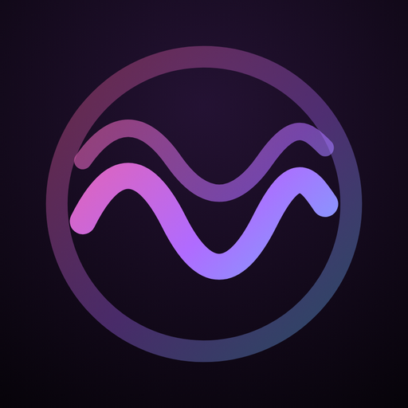
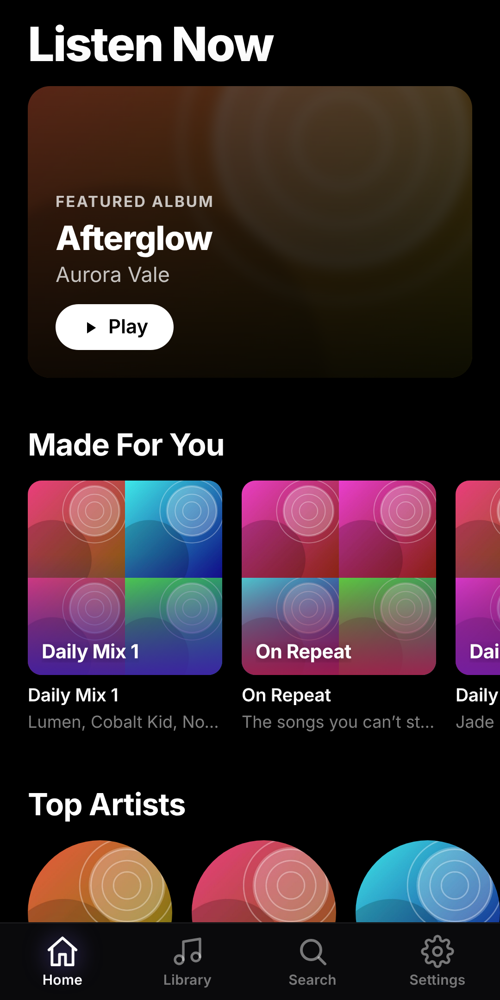
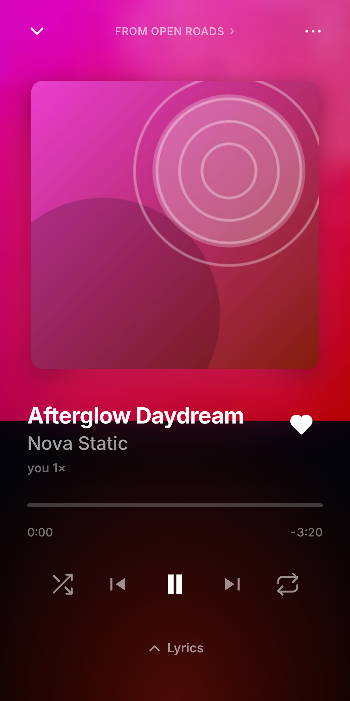
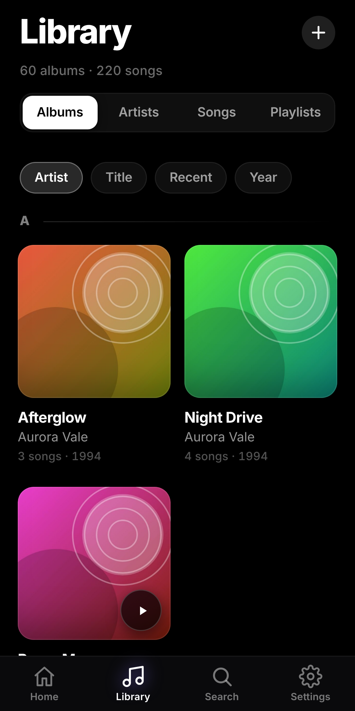
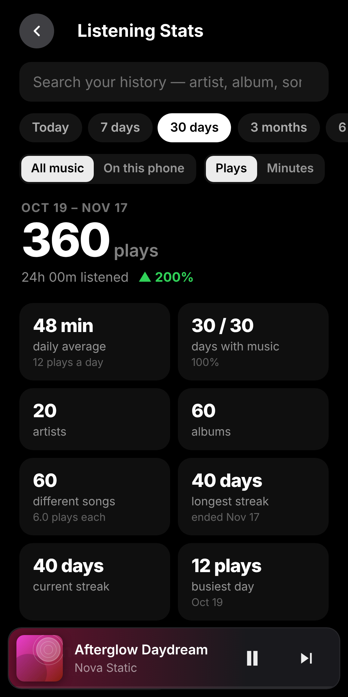

<p align="center"></p>

<h1 align="center">Onda</h1>

<p align="center"><b>A fast, private music player for the songs already on your phone.</b><br>
No account. No ads. No tracking. Works fully offline.</p>

<p align="center">


</p>

<p align="center">




</p>

## Why Onda

Onda plays the music that is already on your phone and gets out of the way. Your library, favourites, playlists
and listening stats stay on your device. There is nothing to sign up for.

- **Plays properly:** gapless playback that keeps going with the screen off, lock-screen controls, a 10-band
  equalizer, playback speed, sleep timer with fade-out, and car mode.
- **Tidy library:** finds your songs automatically, merges messy tags (Hip-Hop / Hip Hop / hip hop become one genre)
  and uses the covers inside your own files first.
- **Lyrics and artist pages:** synced lyrics saved on your phone, artist photos and bios.
- **Playlists and mixes:** your own playlists, Smart Playlists that fill themselves, and Daily Mixes.
- **Listening stats:** by day, month or year, with streaks and an optional Last.fm import.
- **Light on battery and data:** a mobile-data saver that fetches artwork only on Wi-Fi.
- **Yours:** 14 colour themes, backup and restore.

## Get it

Onda is on Uptodown and APKPure. Search for **Onda Music Player**. F-Droid is on the way. Google Play is the goal.

Onda asks for permission to read your music files, and for notifications so the player
controls can show.

## Privacy

Onda has no account, no ads, no analytics and no crash reporting. Your music is never uploaded. When the optional
online features are on, only song, artist and album *names* are sent to public music databases to fetch covers,
lyrics and artist info, and you can switch them off in Settings. Read the full policy in [PRIVACY.md](PRIVACY.md).

## Build it yourself

```
npm install
npx cap add android
node scripts/patch-native.mjs
npx cap sync android
cd android && ./gradlew assembleDebug
```

More detail is in [DEVELOPERS.md](DEVELOPERS.md). The optional Cloudflare Worker proxy lives in [`worker/`](worker/).

## Support Onda

Onda is free, has no ads and no paid version. Getting onto Google Play costs money, so donations are what pays for
it. Every bit helps, and thank you.

Questions, bugs and ideas: **[t.me/ErikasAdo](https://t.me/ErikasAdo)**. You can also send Telegram Stars and gifts there.

| Coin | Address |
|---|---|
| Bitcoin | `bc1qqtujwqdshtvpzsx9zdfd7vlpkl0a0xuv8w7chc` |
| Bitcoin Cash | `qpmxnf4yhyfz6572rada8wrluhqkjvdnx59zesw0ue` |
| Monero (XMR) | `43HodDtY6nm4oz5pJTieGeA4wvu4obNQXPkdjjLPixna7uY3m3v5wrhW5GHHEAVdX3EpYZ9too7zGfTD4YYSGcKF8R8TnCA` |
| Ethereum | `0x9f2bBb5AA61587Ac46955B7DC5ec1A88A6E3F2D0` |
| Dogecoin | `DCpepDd41o8u3J6TsCVNcCL8oA9ZwvmpFB` |

These are the only donation addresses for this project.

## Licence

[GPL-3.0-or-later](LICENSE).
